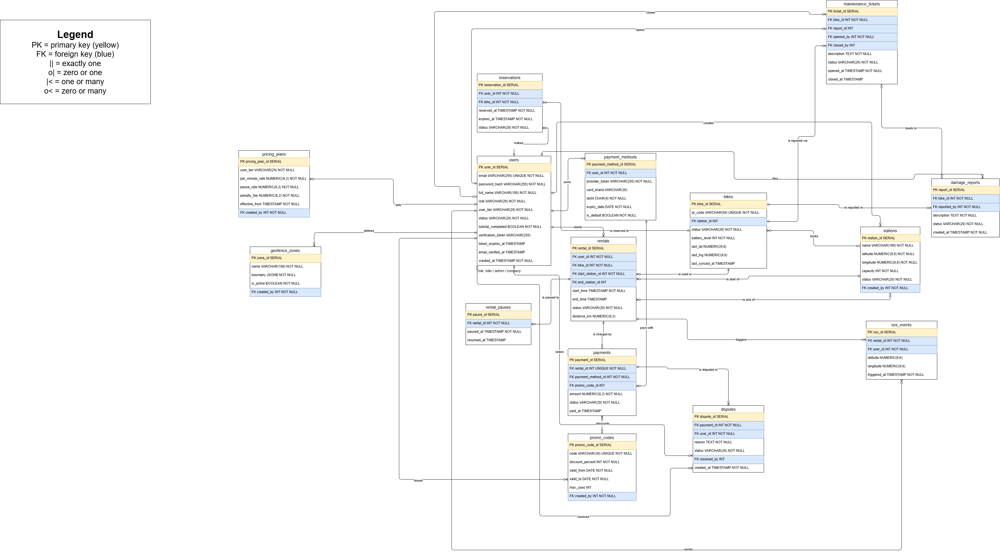

# Smart Bike Rental App - Omar

Software Engineering - GIU Cairo - Milestone 2

## Team

| Name | ID | Role in team |
|------|----|--------------|
| Omar Emam | <your 19011610> |  |

## ERD

Editable diagram: [erd.drawio](docs/erd.drawio)

Notation: crow's foot. `PK` = primary key (yellow), `FK` = foreign key (blue).
All three roles (rider, admin, company) are stored in the single `users` table
using the `role` column.

## Traceability: entities to user stories

| Entity | Justified by user stories |
|--------|---------------------------|
| users | US-001, US-012, US-020, US-022 |
| payment_methods | US-003, US-006 |
| stations | US-002, US-004, US-021 |
| bikes | US-002, US-003, US-008, US-013, US-014, US-016 |
| rentals | US-003, US-005, US-007, US-010 |
| rental_pauses | US-011 |
| reservations | US-009 |
| pricing_plans | US-022 |
| promo_codes | US-024 |
| payments | US-003, US-005, US-006, US-007, US-024 |
| damage_reports | US-008, US-016 |
| maintenance_tickets | US-014, US-016, US-018 |
| geofence_zones | US-017 |
| disputes | US-027 |
| sos_events | US-026 |

Stories that need no extra table: US-015 (demand heat map), US-019 (utilization
reports) and US-023 (dashboard) are queries over `stations`, `bikes` and `rentals`;
US-028 (accessibility) is a UI requirement; US-025 (data export) is Won't-Have.

## Database

- DBMS: PostgreSQL <your version>
- Database name: smart_bike_rental
- Scripts are in the `schema/` folder; run them in numeric order:
  1. `01_create_tables.sql` - creates the 15 tables
  2. `03_seed_data.sql` - sample rows for every table
  3. `04_test_constraints.sql` - statements that must all fail (constraint tests)
